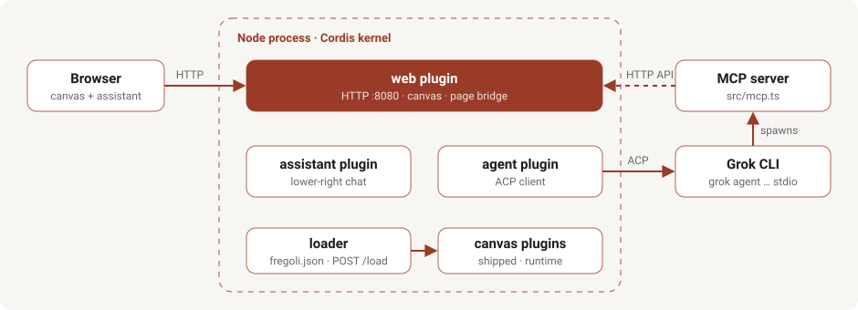

# Fregoli

<p align="center">
  <picture>
    <source media="(prefers-color-scheme: dark)" srcset="docs/assets/fregoli-logo-dark.svg">
    <source media="(prefers-color-scheme: light)" srcset="docs/assets/fregoli-logo-light.svg">
    
  </picture>
</p>

[](https://github.com/pihme/fregoli/actions/workflows/ci.yml)
[](https://github.com/pihme/fregoli/releases?q=fregoli)
[](LICENSE)
[](https://pihme.github.io/fregoli/)

Fregoli is a web application an agent can rewrite *while it is running*. Instead of editing files and restarting the process, capabilities are [Cordis](https://github.com/cordiverse/cordis) plugins that are mounted and unmounted in a live Node process. The name comes from [Leopoldo Fregoli](https://en.wikipedia.org/wiki/Leopoldo_Fregoli) (1867–1936), the quick-change artist: one performer, many appearances, no restart of the show.

On start you get a canvas on port 8080 and an assistant chat in the lower right. Chat goes to the **Grok CLI** over ACP when `grok` is on `PATH`, otherwise to an in-process stub. Grok receives an MCP server that lets it observe the page, load and unload plugins, highlight elements and wait for the user to click.

The CLI name is `fregoli` in full; do not shorten to `freg`.

- [Website](https://pihme.github.io/fregoli/) — handbook and current status
- [Specification](SPEC.md) — product spec
- [Usage guide](USAGE.md) — CLI, HTTP, Grok, Docker
- [Contributing](CONTRIBUTING.md) — issues welcome, outside pull requests not accepted for now

## The three questions

Fregoli is built around three questions:

1. What if you no longer have to buy software off the shelf, but can build it yourself?
2. What if software is not delivered fully baked, but can change constantly?
3. What if AI does not just build the software, but can then also take on tasks inside that software that deterministic software cannot do?

## Getting started

Needs Node 22+. For a real agent, the Grok CLI on `PATH` (authenticated via Grok CLI login or `XAI_API_KEY`).

```bash
git clone https://github.com/pihme/fregoli.git
cd fregoli
npm ci
npx tsx src/cli.ts              # http://127.0.0.1:8080/
npx tsx src/cli.ts --assistant  # force the stock assistant UI
npx tsx src/cli.ts --version
npm link                        # puts `fregoli` on PATH; uses the tsx in this checkout
```

A welcome canvas (`plugins/shipped/welcome.ts`) is shown at boot. The assistant in the lower right is a [Helferlein](https://github.com/pihme/helferlein) figure (v1.0.0): resting, it opens the chat; while the chat is open it floats above the panel. A change the agent applies rolls a new look, and the browser remembers it. Chat goes to Grok over ACP when `grok` is available, otherwise an in-process stub. Starting with `--assistant` forces the stock assistant UI for that start. `npm link` is what makes the `fregoli` command exist. It does not need a global `tsx`.

Run the tests (the merge gate):

```bash
npm test
```

Container image ([Hermetarium](https://github.com/pihme/hermetarium) is a recommended habitat, not a requirement):

```bash
docker build -t fregoli:local --build-arg FREGOLI_VERSION="$(git describe --tags --match 'fregoli/v*' 2>/dev/null || echo dev)" .
docker run --rm -p 8080:8080 fregoli:local
```

The image listens on `0.0.0.0:8080`, includes `plugins/shipped/`, `fregoli.json`, and `.grok/skills/fregoli-app/`, and installs `iproute2` and `iptables` for a Hermetarium wall. A local process still listens on `127.0.0.1` unless you pass `--host` or set `FREGOLI_HOST`.

Saved config lives in `fregoli.json` in the process working directory. Load and unload write it, so a runtime plugin and a removed assistant survive a restart:

```json
{ "assistant": true, "plugins": [] }
```

`fregoli/vX.Y.Z` GitHub Releases attach a source tarball stamped with that version. `--version` prints `FREGOLI_VERSION` if set, otherwise `git describe --tags --match 'fregoli/v*'`, otherwise `dev`. Full CLI and HTTP reference: [usage guide](USAGE.md).

## Architecture



The agent plugin spawns `grok agent --always-approve stdio` and passes the MCP server spec in ACP `session/new`; Grok starts `src/mcp.ts` with `FREGOLI_URL` pointing back at this process. Shipped plugins (`plugins/shipped/`) mount at boot; runtime plugins via `fregoli.json` or `POST /load`.

The **kernel** is Cordis. Capabilities are plugins ("fibers") that can be mounted and disposed at runtime.

**Web** serves HTTP on 8080, the canvas, the assistant slot, a JSON API and the page bridge (DOM snapshot, highlight, user click).

**Agent** spawns `grok agent --always-approve stdio` and speaks ACP. It hands Grok an MCP server: `list_plugins` (mounted Cordis fibers), `load_plugin` (mount a plugin file), `unload_plugin` (dispose a fiber by name), `observe_page` (serialized DOM of the current tab), `highlight` (highlight a CSS selector), `wait_click` (highlight a selector and wait for the user to click or type), `reload_page` (reload the browser tab; assistant chat stays open). Without `grok` it falls back to a stub. Unload kills that child.

**Assistant** is its own plugin: lower-right chat, replaceable and removable. The stock UI is the Helferlein avatar described above.

**Loader** mounts extra Cordis plugins from `fregoli.json` or `POST /load`, and writes `fregoli.json` when a plugin is loaded or unloaded. A failed `apply` does not become `ACTIVE` and does not replace the canvas.

## Layout

| Path | Contents |
| --- | --- |
| `src/cli.ts`, `src/boot.ts`, `src/kernel.ts` | CLI entry, boot sequence, Cordis context |
| `src/loader.ts`, `src/config.ts` | Plugin loader/unloader, `fregoli.json` handling |
| `src/mcp.ts` | MCP server handed to Grok |
| `src/plugins/{web,agent,assistant}/` | Boot plugins (tracked) |
| `plugins/shipped/` | Canvas plugins shipped with the repo; every `*.ts` mounts at boot |
| `plugins/runtime/` | Plugins the agent writes at runtime (gitignored) |
| `.grok/skills/fregoli-app/` | Grok skill: how to change the running app |
| `tests/` | `node:test` suites run via `tsx` |
| `docs/images/` | Diagrams used in this README and on the website |

## How this project is built

Fregoli is developed agent-first. AI coding agents write all code,
tests, and documentation, and review each other's changes, under human
direction: specs, design decisions, and acceptance based on observed
behaviour and test results. No human reads the code line by line. This
is a deliberate choice. Quality rests on automated tests, CI, and
independent agent review.

Evaluate the code against your own requirements before you depend on it.
Found a problem? Open an issue.

License: [PolyForm Noncommercial 1.0.0](LICENSE). Source-available, not OSI Open Source. Third-party software and its licenses: [THIRD_PARTY_NOTICES.md](THIRD_PARTY_NOTICES.md).
