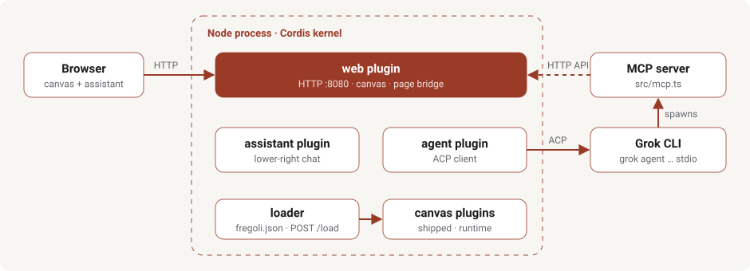

# Fregoli

<p align="center">
  <picture>
    <source media="(prefers-color-scheme: dark)" srcset="docs/assets/fregoli-logo-dark.svg">
    <source media="(prefers-color-scheme: light)" srcset="docs/assets/fregoli-logo-light.svg">
    
  </picture>
</p>

[](https://github.com/pihme/fregoli/actions/workflows/ci.yml)
[](https://github.com/pihme/fregoli/releases?q=fregoli)
[](LICENSE)
[](https://pihme.github.io/fregoli/)

Fregoli is a web app you change by talking to it. The page stays open. You describe what you want, and the app changes in place. The name comes from [Leopoldo Fregoli](https://en.wikipedia.org/wiki/Leopoldo_Fregoli) (1867–1936), the quick-change artist: one performer, many appearances, no restart of the show.

Part of [Hobelbank](https://pihme.github.io/hobelbank/), a set of projects on building software in the age of AI.

Open it and you get a page, plus a small figure in the lower right. That figure is the chat. Ask it to change the page. The page stays still while it works. When the answer is ready, the figure turns away, the page updates once, and the chat is still there.

- [Website](https://pihme.github.io/fregoli/) — handbook and current status
- [Specification](SPEC.md) — product spec
- [Usage guide](USAGE.md) — CLI, HTTP, Grok, Docker
- [Contributing](CONTRIBUTING.md) — issues welcome, outside pull requests not accepted for now

## The three questions

Fregoli is built around three questions:

1. What if you no longer have to buy software off the shelf, but can build it yourself?
2. What if software is not delivered fully baked, but can change constantly?
3. What if AI does not just build the software, but can then also take on tasks inside that software that deterministic software cannot do?

## Current status

This is an MVP. You can describe a page, point at part of it, and see one update when the answer is ready. That works in principle. It feels clunky. The first reply is usually very long. The chat says `Working`, and the page stays as it is until that reply is done. Making the first reply faster is planned for 2.0 in [#36](https://github.com/pihme/fregoli/issues/36).

## Getting started

You need Node 22 or newer. For a real conversation, install the Grok CLI and sign in, or set `XAI_API_KEY`. Without Grok, the chat still opens and answers with a stand-in.

The command is `fregoli`, in full. Do not shorten it to `freg`.

```bash
git clone https://github.com/pihme/fregoli.git
cd fregoli
npm ci
npx tsx src/cli.ts              # http://127.0.0.1:8080/
npx tsx src/cli.ts --assistant  # force the stock assistant UI
npx tsx src/cli.ts --version
npm link                        # puts `fregoli` on PATH; uses the tsx in this checkout
```

Then open http://127.0.0.1:8080/. A short welcome is on the page, and the figure sits in the lower right. `npm link` puts the `fregoli` command on your PATH for this checkout. `--assistant` brings the figure back for that start if you had removed it.

Run the tests (the merge gate):

```bash
npm test
```

Container image ([Hermetarium](https://github.com/pihme/hermetarium) is a recommended habitat, not a requirement):

```bash
docker build -t fregoli:local --build-arg FREGOLI_VERSION="$(git describe --tags --match 'fregoli/v*' 2>/dev/null || echo dev)" .
docker run --rm -p 8080:8080 fregoli:local
```

The image listens on `0.0.0.0:8080`, includes `plugins/shipped/`, `fregoli.json`, and `.grok/skills/fregoli-app/`, and installs `iproute2` and `iptables` for a Hermetarium wall. A local process still listens on `127.0.0.1` unless you pass `--host` or set `FREGOLI_HOST`.

Changes you make through the chat are remembered in `fregoli.json`, in the folder where you started Fregoli. Removing the assistant is remembered too:

```json
{ "assistant": true, "plugins": [] }
```

`fregoli/vX.Y.Z` GitHub Releases attach a source tarball stamped with that version. `--version` prints `FREGOLI_VERSION` if set, otherwise `git describe --tags --match 'fregoli/v*'`, otherwise `dev`. Full CLI and HTTP reference: [usage guide](USAGE.md).

## Working with the agent

Click the figure to open the chat. The figure is a [Helferlein](https://github.com/pihme/helferlein) (v1.0.0). Resting, it is the button that opens the panel. While the chat is open it floats above the panel, and it remembers its look.

Type what you want and send. One line in the chat shows what it is doing, such as `Working (read file)`. The same step again shows a count, `Working (read file 2x)`. The page you are looking at stays as it is.

When the reply is finished, the figure turns away, the page loads the result, and the figure turns back. The chat stays open and scrolls to the latest message. A reply that leaves the page unchanged skips that turn. A reply that runs longer than five minutes stops, and it is not tried again on its own.

### Pointing

Point is how you show which part of the page you mean.

With the chat open, press **Point** next to Close. The cursor becomes a crosshair. Move over the page. A filled highlight wraps the thing you would click, and a label names it, such as `Button · Save`.

Click to choose it. Pointing ends, and a chip above the message box shows the same label. The × on the chip clears it. Press **Point** again, or Escape, to back out before you click. Closing the chat backs out of an unfinished point. A chip you already chose stays, so you can close the chat and send it later.

Write what should happen, or send the point on its own. Your message begins with `Pointed at Button “Save”`. The chat itself cannot be pointed at.

The agent sometimes highlights something on the page. That box is the same kind of mark.

## Architecture



The agent plugin spawns `grok agent --always-approve stdio` and passes the MCP server spec in ACP `session/new`; Grok starts `src/mcp.ts` with `FREGOLI_URL` pointing back at this process. Shipped plugins (`plugins/shipped/`) mount at boot; runtime plugins via `fregoli.json` or `POST /load`.

The **kernel** is Cordis. Capabilities are plugins ("fibers") that can be mounted and disposed at runtime.

**Web** serves HTTP on 8080, the canvas, the assistant slot, a JSON API and the page bridge (DOM snapshot, highlight, user click).

**Agent** spawns `grok agent --always-approve stdio` and speaks ACP. It hands Grok an MCP server: `list_plugins` (mounted Cordis fibers), `load_plugin` (mount a plugin file), `unload_plugin` (dispose a fiber by name), `observe_page` (the tab on screen, plus `nextCanvas`, the canvas HTML the server will serve when the reply finishes), `highlight` (fill a canvas element), `wait_click` (highlight a selector and wait for the user to click or type), `reload_page` (hold one reload until the reply finishes). A turn longer than five minutes is cancelled and that Grok child is replaced. The timed-out prompt is not sent again. Without `grok` it falls back to a stub. Unload kills that child.

**Assistant** is its own plugin: lower-right chat, replaceable and removable. The stock UI is the Helferlein avatar described above, with a Point button at the top of the panel. The thread for that tab is kept in `sessionStorage`.

**Loader** mounts extra Cordis plugins from `fregoli.json` or `POST /load`, and writes `fregoli.json` when a plugin is loaded or unloaded. A failed `apply` does not become `ACTIVE` and does not replace the canvas.

## Layout

| Path | Contents |
| --- | --- |
| `src/cli.ts`, `src/boot.ts`, `src/kernel.ts` | CLI entry, boot sequence, Cordis context |
| `src/loader.ts`, `src/config.ts` | Plugin loader/unloader, `fregoli.json` handling |
| `src/mcp.ts` | MCP server handed to Grok |
| `src/plugins/{web,agent,assistant}/` | Boot plugins (tracked) |
| `plugins/shipped/` | Canvas plugins shipped with the repo; every `*.ts` mounts at boot |
| `plugins/runtime/` | Plugins the agent writes at runtime (gitignored) |
| `.grok/skills/fregoli-app/` | Grok skill: how to change the running app |
| `tests/` | `node:test` suites run via `tsx` |
| `docs/images/` | Diagrams used in this README and on the website |

## How this project is built

Fregoli is developed agent-first. AI coding agents write all code,
tests, and documentation, and review each other's changes, under human
direction: specs, design decisions, and acceptance based on observed
behaviour and test results. No human reads the code line by line. This
is a deliberate choice. Quality rests on automated tests, CI, and
independent agent review.

Evaluate the code against your own requirements before you depend on it.
Found a problem? Open an issue.

License: [PolyForm Noncommercial 1.0.0](LICENSE). Source-available, not OSI Open Source. Third-party software and its licenses: [THIRD_PARTY_NOTICES.md](THIRD_PARTY_NOTICES.md).
